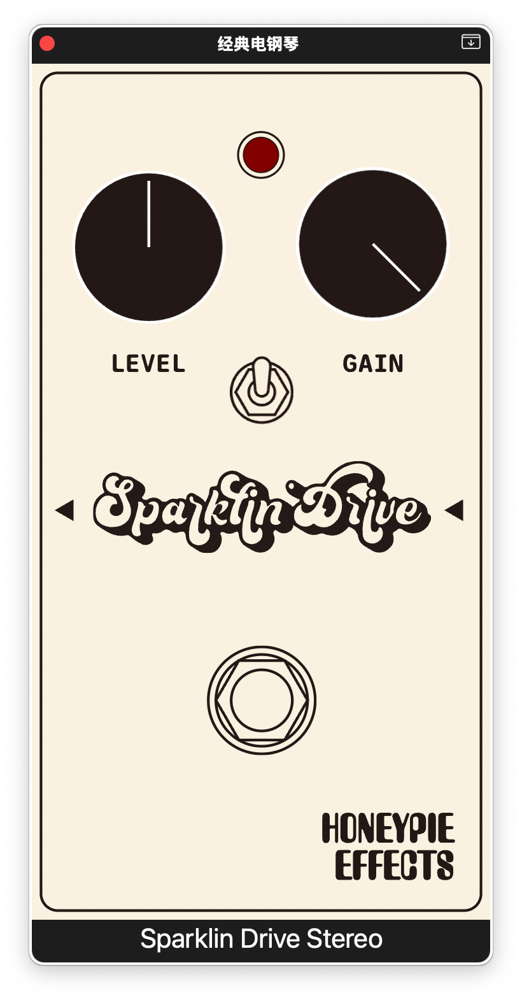
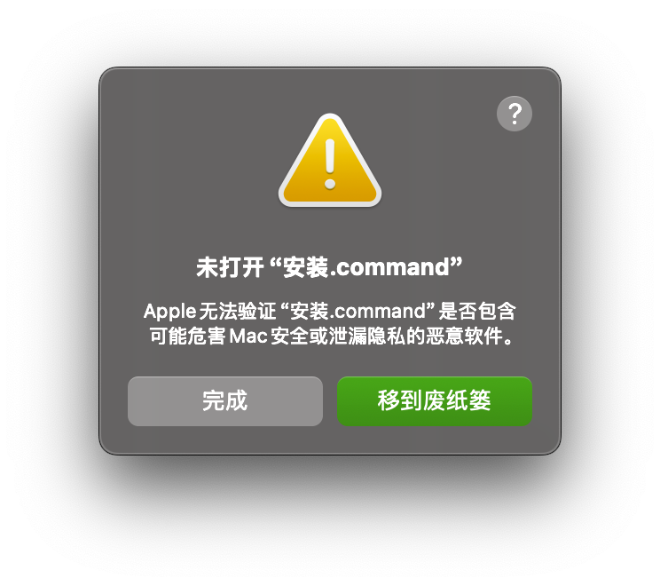
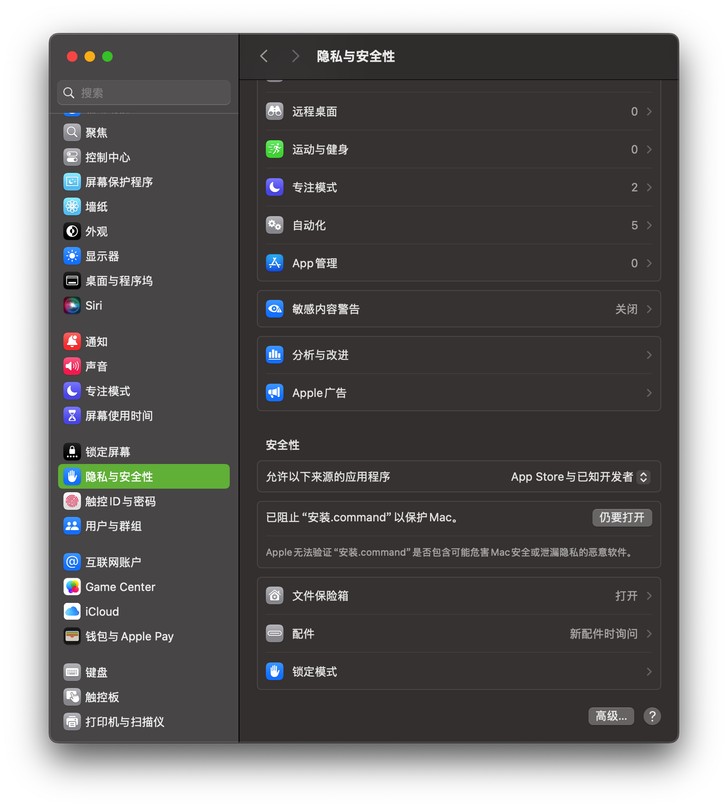

<p align="center">
  <picture>
    <source media="(prefers-color-scheme: dark)" srcset="pictures/sparklin_drive_logo_reverse.png">
    
  </picture>
</p>

# Sparklin Drive

**一块像气泡水一样的过载单块**：清爽、颗粒分明，采用 Rust 构建。

`AU` · `VST3` · `CLAP` ｜ macOS · Windows · Linux ｜ GPL-3.0 开源



**[下载](#获取与安装)** ｜ **[亲手构建](doc/current/build.md)** ｜ **[用它做自己的单块](#用它做你自己的单块)**

---

## 面板与音色

60 × 112 mm 的面板：两颗旋钮、一个拨杆、一个脚踏，没有隐藏菜单，拧起来不用看说明书。

| 部件 | 功能 |
|---|---|
| **GAIN**（左上） | 增益级。 |
| **LEVEL**（右上） | 输出音量。 |
| **Clip Mode**（中间拨杆） | 上：**非对称**削波（原机接法，偶次谐波充足，暖、有肉）；下：**对称**削波（偶次谐波被抑制，收紧、整齐、更适合叠在其他失真前面） |
| **LED**（顶部） | 削波指示。跟着演奏实时亮灭，轻拨闪一下就灭，重扫会亮住不放 |
| **脚踏 3PDT** | True-bypass。 |

### 音色

**气泡水**。低频紧实不糊，中高频一拨就跳到前面来，起音的那一下特别脆 —— 像刚开瓶的苏打，
气泡在舌尖上扎一下就没，不拖尾巴。所以它更擅长：

- **轻过载 / 加味**：GAIN 30–50%，给清音加一层"玻璃感"的边缘，扫弦时每个音都听得见
- **节奏失真**：GAIN 60–80%，非对称档，和弦有咬劲但依然分得开
- **推箱头 / 叠推子**：GAIN 低 + LEVEL 高，当作推动级；对称档更好叠，不容易糊

Mono 与 Stereo 是两个**独立的插件身份**（`Sparklin Drive Mono` / `Sparklin Drive Stereo`），
宿主里按通道数选。

---

## 技术简介

| | |
|---|---|
| **自研框架** | 用 [rustomp](https://github.com/amonisachicken/rustomp) 构建。电路网表 → 器件级 MNA 求解 → 实时引擎 → 插件外壳，整条链路都是本项目的代码 |
| **来自真实电路** | 不是采样、不是神经网络拟合、不额外加 EQ。音色是**把真实单块电路写成 SPICE 网表后逐样本求解**出来的：OP07 运放、1N4148 削波环、250k 电位器、9V 单电源，与 ngspice 逐点对拍 |
| **实时** | 4× 过采样 + 自适应牛顿迭代 + 大跳变子步进，NaN 熔断；旁通与档位切换都做了交叉淡化，不会咔哒 |
| **跨平台** | 同一份网表、同一套面板，产出 macOS（AU / VST3 / CLAP，universal）、Windows（VST3 / CLAP，x64）、Linux（VST3 / CLAP，x64） |

电路拓扑、器件精度、验证数字与代码结构：**[doc/current/architecture.md](doc/current/architecture.md)**。
（网表就在 `circuit/netlist/`，`ngspice` 可以直接跑。）

---

## 获取与安装

### 1. 下载

到 **[Releases](https://github.com/amonisachicken/sparklin-drive/releases)** 取对应平台的包：

| 平台 | 下载文件 | 说明 |
|---|---|---|
| **macOS**（Intel + Apple Silicon） | `Sparklin-Drive-<ver>-macOS.dmg` | 双击打开，里面是「安装.command」；装 AU / VST3 / CLAP |
| | `Sparklin-Drive-<ver>-macOS-plugins.zip` | 手动版：三个插件直接拖进 `~/Library/Audio/Plug-Ins/` |
| **Windows x64** | `...-Windows-x64-Setup-per-user.msi` | 用户级安装，**不需要管理员**（推荐） |
| | `...-Windows-x64-Setup-system.msi` | 系统级，需要管理员；**两种只装一种** |
| | `...-Windows-x64-plugins.zip` | 手动版：解压后把 `.vst3` / `.clap` 放到插件目录 |
| **Linux x64** | `Sparklin-Drive-<ver>-Linux-x64.tar.gz` | 解包后 `./install.sh`（用户级）或 `sudo ./install.sh --system` |

> **未签名技术预览**：这是个人项目阶段的分发方式，macOS 的 Gatekeeper 和 Windows 的
> SmartScreen 都可能出声拦你。下面的步骤会教你 30 秒放行。校验和见同页面的 `SHA256SUMS.txt`。

### 2. macOS：被 Gatekeeper 拦住怎么办

打开 DMG，双击「安装.command」，会先看到这个 —— **点「完成」**（千万别点「移到废纸篓」）：



然后打开 **系统设置 → 隐私与安全性**，往下滚到「安全性」一节，
点「已阻止"安装.command"以保护 Mac」旁边的 **「仍要打开」**，再在弹窗里确认一次「打开」：



装完的插件在 `~/Library/Audio/Plug-Ins/{Components,VST3,CLAP}/`。

<details>
<summary>两种替代做法</summary>

- 在 Finder 里**右键**「安装.command」→「打开」→ 弹窗里再点「打开」；
- 或者先去掉隔离属性再双击：
  `xattr -dr com.apple.quarantine ~/Downloads/Sparklin-Drive-*.dmg`
  （对 `.command` 本身也执行一次 `xattr -d com.apple.quarantine` 更保险）。

</details>

### 3. Windows / Linux

- **Windows**：双击 MSI 下一步到底即可（per-user 版不弹 UAC）。装完在
  `%LOCALAPPDATA%\Programs\Common\`；SmartScreen 拦截时点「更多信息」→「仍要运行」。
  两个 MSI **只能装一个**，装过了记得先卸载。
- **Linux**：

  ```bash
  tar xzf Sparklin-Drive-<ver>-Linux-x64.tar.gz && cd Sparklin-Drive-<ver>-Linux-x64
  ./install.sh            # 用户级：~/.vst3 / ~/.clap
  sudo ./install.sh --system   # 系统级
  ```

  分发包基线是 Ubuntu 22.04（glibc 2.35），更老的系统请自行构建。

### 4. 在宿主里用

新建一条轨道 → 插入插件 → 选 **Sparklin Drive Mono**（单声道）或 **Sparklin Drive Stereo**（立体声）。
宿主没扫到就手动触发一次插件扫描；Logic 里看不到或还显示旧名字，退出 Logic 后清一次 AU 缓存
（自己编译的话：`../rustomp-mac-plugin/scripts/reset-logic-cache.sh`）再打开。

更多平台细节与疑难（DAW 扫描、Logic 缓存、AU 校验）：**[doc/current/build.md](doc/current/build.md)**。

---

## 用它做你自己的单块

**本仓就是模板。** 电路网表、生成代码、面板素材、构建脚本、CI 全部在仓库里。
换掉网表和面板，就是另一台机器：

```bash
git clone https://github.com/amonisachicken/sparklin-drive.git my-drive
cd my-drive && ./scripts/build.sh          # 先确认原样能跑通，再开始改
```

然后按 **[doc/current/making-your-own.md](doc/current/making-your-own.md)** 改四件事 ——
身份（`rustomp.toml`）、电路（网表）、面板（设计器导出）、参数表，附发布前检查清单
与"AU 码发布后不可改"这类容易吃亏的坑。

生态里的其他仓：

| 仓库 | 做什么 |
|---|---|
| [rustomp](https://github.com/amonisachicken/rustomp) | 框架本体：器件库、MNA、实时引擎、代码生成、ngspice 对拍 |
| [rustomp-circuit-designer](https://github.com/amonisachicken/rustomp-circuit-designer) | 原理图设计器（画好直接导出网表） |
| [rustomp-box-designer](https://github.com/amonisachicken/rustomp-box-designer) | 面板设计器（导出 `[ui]` + 素材 PNG） |
| [rustomp-mac-plugin](https://github.com/amonisachicken/rustomp-mac-plugin) | macOS 打包：AU / VST3 / CLAP + DMG |
| [rustomp-win-plugin](https://github.com/amonisachicken/rustomp-win-plugin) | Windows 打包：VST3 / CLAP + MSI |
| [rustomp-linux-plugin](https://github.com/amonisachicken/rustomp-linux-plugin) | Linux 打包：VST3 / CLAP + tar.gz |
| [sparklin-drive-legacy](https://github.com/amonisachicken/sparklin-drive-legacy) | 最早的手推 WDF 实现，已冻结（保留作 AB 基线） |

---

## 开源协议

**GNU GPL-3.0-or-later**，见 [LICENSE](LICENSE)。

| 对象 | 许可 |
|---|---|
| 代码（Rust / 网表 / 脚本） | GPL-3.0-or-later |
| 面板美术（底图、logo、字标） | GPL-3.0-or-later（如需商业授权请联系作者） |
| 第三方依赖 | rustomp（GPL-3.0）、nih-plug（ISC）、egui（MIT / Apache-2.0） |

实际含义：可以自由使用、修改、再分发，**商业使用也可以**；但分发（含二进制）时必须
提供对应源码，且衍生作品同样以 GPL-3.0 授权。用它当模板做的单块也一样 ——
这既是约束，也是这一整套工具链能一直开源的原因。

---

<sub>构建 / 二次开发 / 发布 / 历史留档：[`doc/README.md`](doc/README.md)</sub>
